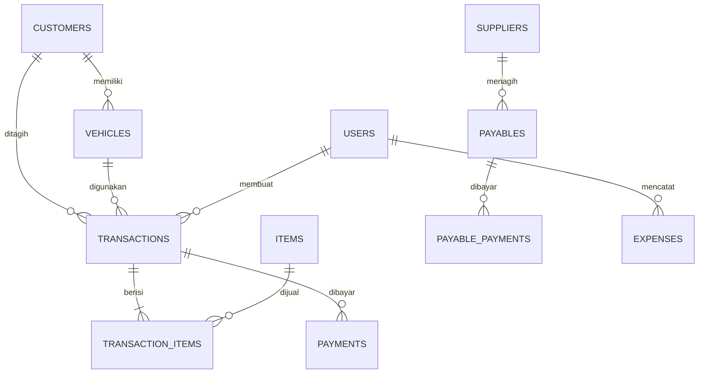

# WMC 225 — Manajemen Bengkel Mobile-First

Aplikasi fullstack untuk **WMC 225** yang menyatukan nota servis, pendapatan, piutang, hutang supplier, stok, dan laporan laba dalam satu alur yang nyaman dipakai dari ponsel.

Dibangun dengan **Next.js 16 + Prisma 6 + PostgreSQL**, siap di-deploy ke **Vercel**.

> **Masalah yang diselesaikan:** hutang-piutang tidak ter-tracking, pencatatan pendapatan berantakan, dan transaksi tidak tercatat sistematis.


## Fitur utama

| Masalah bengkel | Solusi di WMC 225 |
| --- | --- |
| Piutang pelanggan tidak terlacak | Nota mendukung pembayaran penuh, DP, atau belum bayar. Sisa tagihan otomatis muncul di **Piutang**, lengkap dengan jatuh tempo, aging, pembayaran cepat, dan pengingat WhatsApp. |
| Pendapatan tidak rapi | Setiap penerimaan uang dicatat sebagai *payment* yang terhubung ke nota. Laporan memisahkan **omset**, **kas diterima**, **HPP**, **biaya**, dan **laba**. |
| Transaksi tidak sistematis | Nota digital berurutan, rincian jasa/sparepart, mekanik, kendaraan, diskon, pembayaran, serta jejak pembuat nota. |
| Hutang ke supplier | Modul **Hutang Supplier** mencatat tagihan, termin pembayaran, jatuh tempo, dan sisa kewajiban. |
| Stok tidak terkontrol | Stok sparepart otomatis berkurang saat nota disimpan, dengan pengingat stok minimum. |
| Laporan sulit dibuat | Laporan bulanan, rincian harian, komposisi pengeluaran, metode pembayaran, dan ekspor CSV. |
| Akses dari ponsel | UI mobile-first, bottom navigation, PWA installable, dan halaman offline. |
| Kontrol pemilik | Role **Pemilik** dan **Kasir**, dengan modul sensitif hanya untuk pemilik. |
| Siap deploy Vercel | Database PostgreSQL terkelola, Prisma Client singleton, migrasi berversi, dan petunjuk deployment. |

## Tampilan

| Mobile dashboard | Piutang | Laporan |
| --- | --- | --- |
|  |  |  |

## Stack

- **Next.js 16** (App Router, Server Components, Server Actions) + **React 19** + **TypeScript strict**
- **Tailwind CSS 4** dengan design system kustom
- **Prisma ORM 6** + **PostgreSQL 16**; schema, migration, dan seed berversi
- **Auth lokal**: cookie HttpOnly bertanda tangan JWT (`jose`) + hash password `bcryptjs`
- **PWA**: manifest, service worker, offline fallback, ikon maskable
- **Vitest** (22 unit/integration tests) + **Playwright** (6 E2E tests)
- **Vercel-ready**: Prisma Client singleton, pooled database connection, `DIRECT_URL` untuk migrasi

## Jalankan di lokal

Prasyarat: **Node.js 22+**, **pnpm 9+**, dan **Docker** (opsional jika sudah punya PostgreSQL sendiri).

```bash
# 1. Jalankan PostgreSQL + database test
docker compose up -d

# 2. Siapkan environment (sebelum install, karena postinstall menjalankan prisma generate)
copy .env.example .env       # Windows
# cp .env.example .env       # macOS/Linux
# isi AUTH_SECRET minimal 32 karakter

# 3. Install dependency
pnpm install

# 4. Terapkan schema dan isi data demo
pnpm db:migrate
pnpm db:seed

# 5. Jalankan aplikasi
pnpm dev
```

Buka [http://localhost:3000](http://localhost:3000).

Docker Compose membuat tiga database: `wmc225` (development), `wmc225_e2e` (Playwright), dan `wmc225_test` (Vitest).

### Akun demo

| Role | Email | Kata sandi |
| --- | --- | --- |
| Pemilik | `owner@wmc225.id` | `wmc225` |
| Kasir | `kasir@wmc225.id` | `wmc225` |

> Data demo hanya untuk development. Untuk production gunakan `pnpm db:create-admin` (lihat [DEPLOYMENT.md](docs/DEPLOYMENT.md)) — jangan menjalankan seed demo di production.

### Environment

| Variabel | Wajib | Keterangan |
| --- | --- | --- |
| `DATABASE_URL` | ya | Koneksi PostgreSQL untuk aplikasi. Di Vercel gunakan **pooled URL**. |
| `DIRECT_URL` | ya | Koneksi langsung/non-pooled untuk Prisma Migrate. |
| `AUTH_SECRET` | ya | Secret penandatangan session, minimal 32 karakter acak. |
| `APP_TIMEZONE` | tidak | Default `Asia/Jakarta`. |
| `NEXT_PUBLIC_APP_URL` | tidak | URL publik untuk metadata Open Graph. |
| `E2E_DATABASE_URL` / `TEST_DATABASE_URL` | test | Database terisolasi untuk Playwright/Vitest. |
| `ADMIN_EMAIL` / `ADMIN_NAME` / `ADMIN_PASSWORD` | bootstrap | Hanya untuk `pnpm db:create-admin`. |

## Perintah

```bash
pnpm dev              # development server
pnpm build            # prisma generate + production build
pnpm start            # jalankan production build
pnpm typecheck        # TypeScript strict check
pnpm test             # Vitest unit + integritas seed PostgreSQL
pnpm test:e2e         # Playwright E2E (database terisolasi, port 3100)
pnpm db:migrate       # buat/terapkan migrasi di development
pnpm db:deploy        # terapkan migrasi yang ada (production/CI)
pnpm db:seed          # isi data demo (development)
pnpm db:reset         # reset database + seed demo
pnpm db:studio        # buka Prisma Studio
pnpm db:create-admin  # buat akun owner pertama untuk production
```

E2E dan unit test membutuhkan PostgreSQL lokal. Jalankan `docker compose up -d` sekali, lalu `pnpm test` atau `pnpm test:e2e`. Browser Playwright perlu dipasang sekali: `pnpm exec playwright install chromium`.

## Deploy ke Vercel

Ringkasan langkah:

1. Buat PostgreSQL di **Neon**, **Vercel Postgres**, atau **Supabase**.
2. Simpan **pooled connection** sebagai `DATABASE_URL` dan **direct connection** sebagai `DIRECT_URL`.
3. Set environment di Vercel: `DATABASE_URL`, `DIRECT_URL`, `AUTH_SECRET`, `APP_TIMEZONE`, `NEXT_PUBLIC_APP_URL`.
4. Jalankan migrasi dari mesin lokal/CI: `pnpm db:deploy`.
5. Buat akun owner: `pnpm db:create-admin`.
6. Deploy repository ke Vercel. Build command default sudah menjalankan `prisma generate && next build`.

Panduan lengkap, termasuk Neon/Supabase connection string, connection pooling, migrasi, dan troubleshooting ada di [DEPLOYMENT.md](docs/DEPLOYMENT.md).

## Struktur proyek

```
prisma/
├─ schema.prisma               # model, enum, index, relasi
├─ migrations/                 # SQL migration berversi
├─ seed.ts                     # data demo
└─ create-admin.ts             # bootstrap owner production
src/
├─ actions/                    # Server Actions tervalidasi
├─ app/
│  ├─ (auth)/login/
│  ├─ (app)/                   # shell + dashboard, transaksi, piutang, laporan, dll.
│  └─ api/export/              # ekspor CSV & nota
├─ components/                 # UI, shell, form, chart
└─ lib/
   ├─ db.ts                    # Prisma Client singleton
   ├─ queries/                 # query per domain
   ├─ calculations.ts          # logika uang & aging (unit-tested)
   ├─ dates.ts, format.ts
   ├─ auth.ts                  # session JWT
   └─ csv.ts
public/                        # manifest, service worker, ikon, offline
tests/                         # unit & E2E
docs/                          # deployment, roadmap, riset, arsitektur
docker-compose.yml             # PostgreSQL lokal + database test
```

## Model data singkat



Status pembayaran tidak disimpan sebagai kolom yang bisa tidak sinkron; nilainya dihitung dari `total` nota dan total pembayaran. Detail keputusan, alur transaksi atomik, dan tanggal ada di [ARCHITECTURE.md](docs/ARCHITECTURE.md).

## Roadmap & riset

- [Roadmap produk & teknis](docs/ROADMAP.md)
- [Riset repo GitHub](docs/RESEARCH.md)
- [Panduan pengguna](docs/USER-GUIDE.md)
- [Deployment Vercel + PostgreSQL](docs/DEPLOYMENT.md)
- [Galeri screenshot](docs/SCREENSHOTS.md)

## Catatan keamanan & batasan

- Ini adalah MVP production-minded, bukan SaaS multi-tenant. Satu deployment = satu bengkel.
- Jangan gunakan akun demo di production. Ganti password dan gunakan `AUTH_SECRET` acak yang kuat.
- **Jangan** menjalankan `pnpm db:seed` atau `pnpm db:reset` di production. Seed demo akan mengisi data fiktif.
- `prisma migrate reset` menghapus seluruh data. Gunakan `pnpm db:deploy` untuk production.
- Belum ada audit log granular, manajemen pengguna di UI, reversal pembayaran, atau backup otomatis. Lihat roadmap.
- Pembatalan nota hanya untuk pemilik, hanya jika belum ada pembayaran, dan otomatis mengembalikan stok.
- Laporan adalah alat operasional, **bukan pengganti laporan pajak/akuntansi formal**.
- Gunakan koneksi **pooled** di Vercel. Serverless membuat banyak koneksi singkat; connection limit PostgreSQL dapat habis jika memakai direct URL.

---

Dibuat untuk WMC 225 — bengkel rapi, kas jelas, piutang aman.
