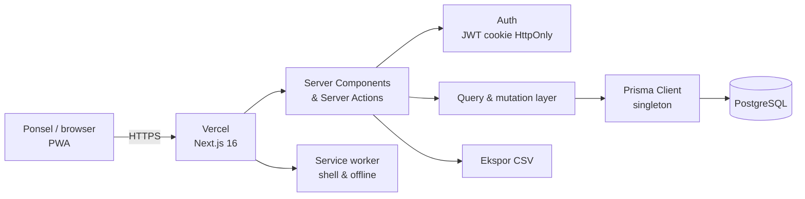
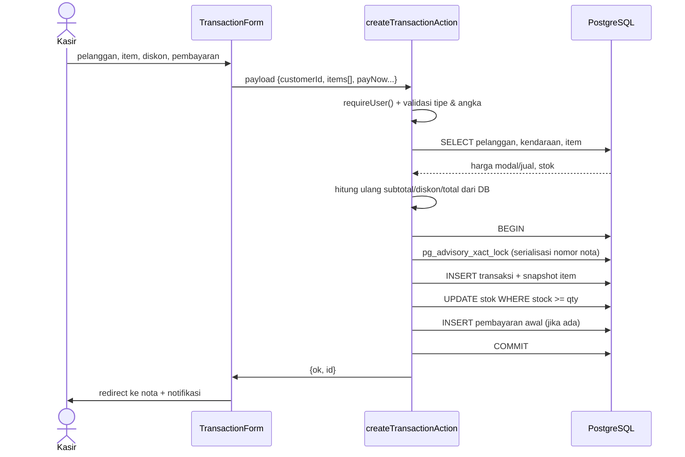
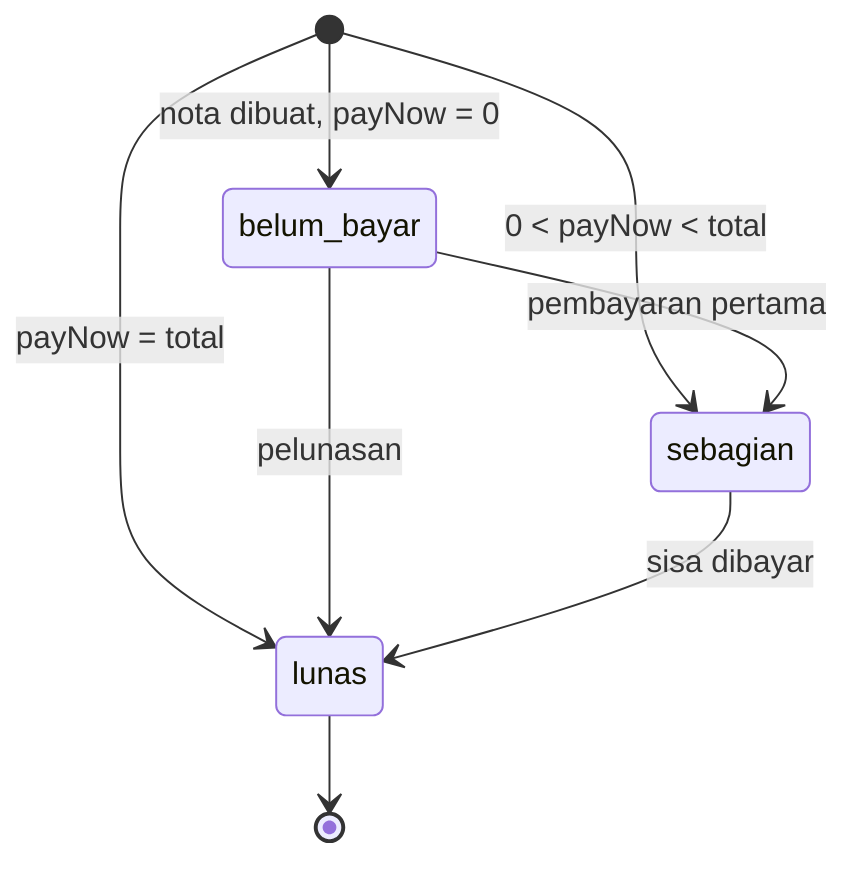
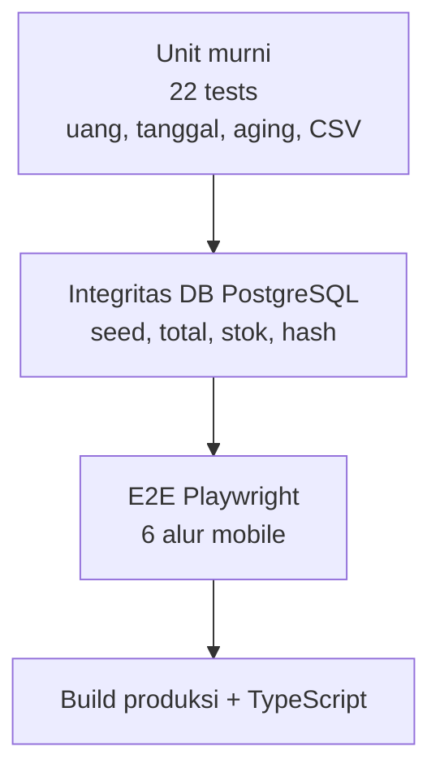

# Arsitektur WMC 225

## Tujuan arsitektur

1. **Satu alur, satu sumber kebenaran.** Nota, item, pembayaran, stok, dan status piutang konsisten di PostgreSQL.
2. **Mobile-first, desktop-capable.** Alur utama nyaman di 390 px; sidebar memperkaya desktop tanpa menduplikasi logika.
3. **Siap serverless.** Prisma Client singleton, koneksi PostgreSQL pooled, migrasi berversi, tanpa state di filesystem.
4. **Aman secara default.** Role, session HttpOnly, validasi server, query terparameterisasi oleh Prisma.
5. **Bisa diuji.** Logika uang/tanggal berupa fungsi murni; integritas database diuji; alur utama diuji end-to-end.

## Diagram sistem

Tidak ada REST API CRUD terpisah. Mutasi memakai **Server Actions**; route handler hanya untuk ekspor CSV/nota. Ini mengurangi permukaan API dan memungkinkan `revalidatePath` yang presisi.

## Lapisan kode

| Lapisan | Lokasi | Tanggung jawab |
| --- | --- | --- |
| Schema & migrasi | `prisma/schema.prisma`, `prisma/migrations/` | Model, enum, relasi, index, riwayat perubahan schema. |
| Seed & bootstrap | `prisma/seed.ts`, `prisma/create-admin.ts` | Data demo lokal; akun owner production tanpa data demo. |
| UI & route | `src/app/(app)/**` | Server Components, `searchParams`, auth guard, render. |
| Client interaction | `src/components/**` | Form builder, dialog pembayaran, item picker, chart, PWA. |
| Mutasi | `src/actions/**` | `"use server"`, auth, validasi, transaksi database, revalidasi. |
| Baca | `src/lib/queries/**` | Query Prisma, agregasi laporan, pemetaan tipe UI. |
| Domain murni | `src/lib/calculations.ts`, `dates.ts`, `format.ts`, `csv.ts` | Logika yang diuji unit. |
| Infrastruktur | `src/lib/db.ts`, `auth.ts` | Prisma singleton, session. |
| Aset | `public/**` | Manifest, service worker, ikon, offline page. |

## Alur tulis transaksi (paling kritis)

**Prinsip penting:** client hanya mengirim `itemId` dan `qty`. Harga, modal, total, diskon, dan status akhir dihitung di server dari database. Ini mencegah manipulasi harga dari browser dan menjaga laporan tetap benar.

## Invariants

| Invariant | Dijaga oleh | Diuji |
| --- | --- | --- |
| `total = subtotal − discount` | action + aplikasi | `database.test.ts` |
| `0 ≤ discount ≤ subtotal` | kalkulasi server | `calculations.test.ts` |
| Total pembayaran ≤ total nota | validasi before create | `calculations.test.ts`, `database.test.ts` |
| Stok tidak negatif | `updateMany WHERE stock >= qty` + rollback | unit + E2E |
| Nomor invoice unik | UNIQUE constraint + sequence di transaksi | database test |
| Nota batal tidak bisa dibayar | guard pembayaran | E2E |
| Nota dengan pembayaran tidak bisa di-void | guard action | E2E |
| Status bayar diturunkan, tidak diketik | `paymentStatus()` | unit test |

## Status pembayaran (derived state)

Tidak ada kolom `status_bayar` yang bisa tidak sinkron. Status dihitung dari `total` dan `SUM(payments.amount)`; query layer memetakan hasilnya ke tipe UI.

## Model data

Sepuluh model inti:

| Model | Peran |
| --- | --- |
| `User` | Akun owner/kasir + hash password + role enum. |
| `Customer` | Identitas pelanggan. |
| `Vehicle` | Kendaraan milik pelanggan. |
| `Item` | Katalog jasa/sparepart; harga, modal, stok, minimum. |
| `Transaction` | Header nota, nomor invoice, tanggal bisnis, jatuh tempo, void. |
| `TransactionItem` | Snapshot nama/harga/modal/qty saat transaksi. |
| `Payment` | Penerimaan pembayaran per nota; sumber laporan kas. |
| `Expense` | Pengeluaran operasional. |
| `Supplier`, `Payable`, `PayablePayment` | Hutang usaha dan pembayarannya. |
| `Setting` | Identitas bengkel dan teks nota. |

Enum PostgreSQL: `UserRole` (owner/kasir), `ItemCategory` (jasa/sparepart), `PaymentMethod` (tunai/transfer/qris), `TransactionStatus` (selesai/batal).

Index ada untuk tanggal bisnis, pelanggan, kendaraan, jatuh tempo, pembayaran, dan pengeluaran.

### Mengapa snapshot item?

Jika harga oli naik bulan depan, nota lama harus tetap menampilkan harga saat transaksi. Karena itu `TransactionItem` menyimpan `name`, `category`, `unitPrice`, `unitCost`, dan `qty` saat itu. Laporan HPP historis tetap valid.

### Mengapa integer rupiah?

Semua nilai uang **integer rupiah**, bukan `Decimal` atau float. Rupiah tidak memakai sen; integer menghindari error pembulatan. Format tampilan melalui `Intl.NumberFormat('id-ID')`.

## Tanggal & zona waktu

- `businessDate`, `dueDate`, `expenseDate`, dan `businessDate` pembayaran menggunakan PostgreSQL `date` (`@db.Date`).
- `createdAt` dan `paidAt` menggunakan `timestamptz` untuk audit dan urutan.
- Tanggal bisnis dihitung menurut `APP_TIMEZONE` (default `Asia/Jakarta`).
- Query layer mengonversi `Date` PostgreSQL ke string `YYYY-MM-DD` agar tipe UI stabil.
- Action mengonversi input `YYYY-MM-DD` menjadi `Date` UTC tengah malam dengan helper `parseDateOnly`.
- Ini mencegah transaksi pukul 00:30 WIB terbaca sebagai tanggal UTC kemarin.

## Laporan: definisi angka

| Metrik | Definisi |
| --- | --- |
| **Omset** | Total nota `selesai` pada tanggal bisnis periode. |
| **HPP** | `qty × unitCost` item terjual pada nota selesai. |
| **Laba kotor** | Omset − HPP. |
| **Biaya operasional** | Total `Expense` periode. Tidak termasuk pembayaran pokok hutang. |
| **Laba bersih** | Omset − HPP − biaya operasional. |
| **Kas diterima** | Total `Payment`, termasuk DP dan pelunasan nota lama. |
| **Kas keluar** | Pengeluaran + pembayaran hutang supplier. |
| **Arus kas bersih** | Kas diterima − kas keluar. |
| **Piutang berjalan** | Total nota selesai − pembayaran, seluruh waktu. |

Omset ≠ kas diterima. Itulah inti perbaikan “pendapatan tidak rapi”: pemilik dapat membedakan penjualan, uang yang benar-benar masuk, dan kewajiban yang masih berjalan.

## Auth & otorisasi

1. Login memverifikasi email + bcrypt, lalu menandatangani JWT (7 hari) dengan `AUTH_SECRET`.
2. JWT disimpan di cookie `wmc225_session` (`HttpOnly`, `SameSite=Lax`, `Secure` di production).
3. Setiap request server memverifikasi JWT dan mengecek user masih ada di database.
4. Layout `(app)` memanggil `requireUser()`; setiap action juga memanggil `requireUser()` — tidak bergantung hanya pada UI.
5. Modul sensitif memakai `requireOwner()`: pengeluaran, hutang supplier, stok, pengaturan, void.
6. UI menyembunyikan menu yang tidak berhak, tetapi server tetap menjadi penjaga utama.

**Belum ada:** rate limit login, MFA, audit log, dan manajemen sesi per perangkat. Lihat roadmap P1.

## Serverless & koneksi database

- `src/lib/db.ts` menyimpan satu `PrismaClient` per proses/instance.
- Vercel dapat membuat banyak instance serverless; gunakan **pooled connection** (`DATABASE_URL`) dengan `connection_limit=1` pada provider seperti Neon/Supabase.
- `DIRECT_URL` hanya untuk Prisma Migrate, bukan untuk query aplikasi.
- Query layer saat ini melakukan beberapa agregasi di JavaScript (misalnya open receivables). Ini memadai untuk skala satu bengkel; saat volume meningkat, pindahkan agregasi ke SQL view/raw query terindeks.
- Pembuatan nomor nota memakai PostgreSQL transaction + advisory lock per bengkel, aman untuk beberapa kasir tanpa sequence global yang dapat bentrok.

## PWA & offline

- `public/manifest.webmanifest`: installable, shortcut transaksi & piutang.
- Service worker network-first untuk navigasi; cache-first hanya aset statis; **tidak meng-cache** `/api/*` maupun halaman HTML berisi data pelanggan.
- Halaman `/offline.html` tampil saat navigasi gagal.
- Data transaksi tidak di-cache. Fitur tulis offline adalah roadmap P2 (butuh sinkronisasi & resolusi konflik).

## Strategi pengujian

- Unit: Vitest, fungsi domain tanpa I/O.
- Integrasi: Vitest global setup me-reset database `wmc225_test`, menjalankan migrasi + seed, lalu memeriksa invariant melalui Prisma.
- E2E: database `wmc225_e2e` terisolasi; server port 3100; uji login, CRUD, pembayaran, void, role gate, ekspor.
- E2E menggunakan viewport Pixel 7 untuk memastikan alur utama benar di mobile.

## Deployment

Persyaratan:
- Node.js 22+, PostgreSQL, dan environment Vercel.
- `DATABASE_URL` pooled dan `DIRECT_URL` direct.
- Jalankan `pnpm db:deploy` sebelum deploy yang mengubah schema.
- Buat owner production dengan `pnpm db:create-admin`; jangan seed demo.
- Backup dan retensi dikelola provider database.

Detail langkah dan troubleshooting ada di [DEPLOYMENT.md](DEPLOYMENT.md).

## Keputusan yang sengaja ditunda

- **Audit log & reversal pembayaran** — penting sebelum production serius, entitas belum dibuat.
- **Stock ledger** — saat ini stok adalah saldo; belum ada histori pergerakan.
- **Nota PDF** — masih CSV/cetak browser; PDF server-side ditunda.
- **Optimistic concurrency** — belum diperlukan untuk single kasir; advisory lock hanya untuk nomor nota.
- **Pagination di level database untuk piutang/laporan** — dataset satu bengkel masih kecil; akan dioptimalkan saat volume bertambah.
